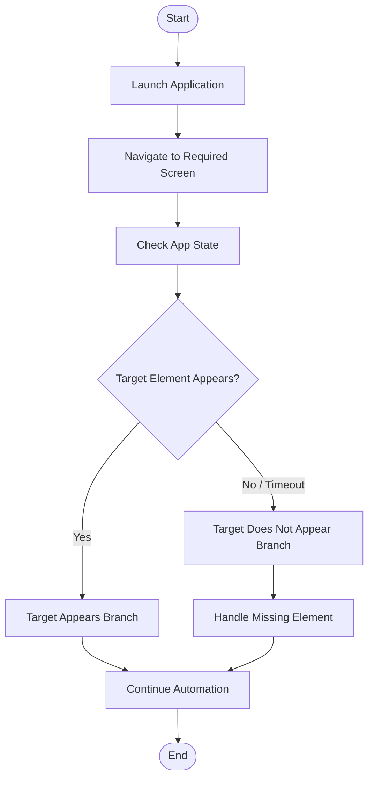

# UiPath Check App State

## Overview

This repository demonstrates the implementation of the **Check App State** activity in UiPath Studio.

Check App State is used to verify whether a specific UI element appears or disappears in a desktop application or web browser. Based on the detected application state, the automation executes the corresponding workflow branch.

This approach helps build reliable and dynamic automations by ensuring that the required UI elements are available before performing subsequent actions.

## Objectives

- Identify whether a UI element exists or appears in an application.
- Check whether a UI element disappears after an action.
- Handle dynamic application behavior.
- Manage optional pop-ups and confirmation messages.
- Execute different workflow paths based on UI conditions.
- Configure appropriate timeout values.
- Improve automation reliability and reduce unexpected failures.

## Key Features

### 1. Target Appears
Checks whether the specified UI element appears within the configured timeout.

- If the element appears, execute the Target Appears sequence.
- If the element does not appear within the timeout, execute the Target Does Not Appear sequence.

### 2. Target Disappears
Checks whether the specified UI element disappears from the application.

- If the element disappears, execute the Target Disappears sequence.
- If the element remains visible, execute the Target Does Not Disappear sequence.

### 3. Timeout Handling
Defines how long the automation should wait for the expected UI state before proceeding to the appropriate branch.

The default timeout is 5 seconds and can be adjusted based on application behavior.

## Workflow Implementation

1. Launch the required desktop application or web browser.
2. Navigate to the required application screen.
3. Configure the Check App State activity.
4. Indicate the target UI element.
5. Select the required condition (Appear or Disappear).
6. Configure the timeout value.
7. Add the required activities inside the respective branches.
8. Execute and validate the automation.

## Process Flow Diagram

## Example Use Cases

- Check whether a login page is displayed.
- Verify whether a success message appears after submitting a form.
- Detect and handle optional pop-up windows.
- Check whether a loading indicator disappears.
- Verify whether a confirmation dialog is displayed.
- Determine whether an application screen has loaded successfully.

## Tools and Technologies

- **UiPath Studio** – Workflow development and automation.
- **Check App State** – Detecting UI element states.
- **Use Application/Browser** – Interacting with desktop applications and web browsers.
- **UI Automation Activities** – Performing application interactions.
- **Timeout Configuration** – Managing wait conditions and execution flow.

## Exception Handling

The automation should account for the following scenarios:

- Target UI element not found.
- Application loading delays.
- Unexpected pop-up windows.
- Application not responding.
- Incorrect or changed UI selectors.
- Timeout while waiting for an expected UI condition.

Appropriate logging and exception-handling mechanisms should be implemented to support troubleshooting.

## Expected Outcome

The automation identifies the application state and executes the appropriate workflow branch based on whether the target element appears or disappears.

This helps prevent unnecessary UI interactions and makes the automation more adaptable to dynamic application behavior.

## How to Run

1. Clone or download the repository.
2. Open the project in UiPath Studio.
3. Restore the required dependencies.
4. Verify the application and target UI element.
5. Configure the timeout value as required.
6. Run the Main.xaml workflow.
7. Validate the execution of the respective branches.

## Best Practices

- Use reliable selectors when indicating UI elements.
- Configure timeout values based on actual application response times.
- Use appropriate application scopes.
- Avoid unnecessary Check App State activities before every UI action.
- Use the Target Appears and Target Does Not Appear branches meaningfully.
- Add logging for important application states.
- Revalidate selectors whenever the application UI changes.

## Purpose

This repository serves as a practical reference for implementing conditional UI automation using the UiPath Check App State activity.

It demonstrates how application states can be verified and handled to build stable, maintainable, and reliable RPA workflows.

---

**Technology:** UiPath RPA  
**Activity:** Check App State  
**Category:** UI Automation
