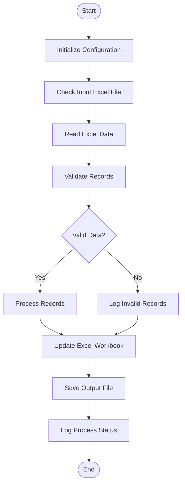

# UiPath Excel Process Automation

## Overview

This repository contains a UiPath RPA automation project designed to automate Excel-based business processes.

The automation demonstrates how to interact with Excel workbooks, read and process data, validate records, update worksheets, and generate the required output.

The objective is to reduce manual effort, minimize data-entry errors, improve data accuracy, and streamline repetitive Excel operations.

## Objectives

- Automate Excel file handling and processing.
- Read data from Excel worksheets.
- Validate and process Excel records.
- Apply business rules and conditions.
- Filter and manipulate Excel data.
- Update existing Excel workbooks.
- Write processed results into Excel sheets.
- Handle exceptions and maintain process reliability.

## Process Workflow

1. **Initialize Process**
   - Set up the required configuration.
   - Identify the input and output file paths.
   - Validate the availability of the input Excel file.

2. **Read Excel Data**
   - Open the Excel workbook.
   - Read data from the required worksheet.
   - Store the data in a DataTable.

3. **Data Validation**
   - Check mandatory fields.
   - Validate data formats and values.
   - Identify empty or invalid records.

4. **Process Records**
   - Iterate through the DataTable.
   - Apply business rules.
   - Perform required calculations and transformations.

5. **Update Excel**
   - Update existing records or create new entries.
   - Write processed data into the required worksheet.
   - Apply necessary formatting, if applicable.

6. **Generate Output**
   - Save the updated Excel workbook.
   - Generate the final processed file.
   - Log the process execution status.

7. **Exception Handling**
   - Handle missing files and worksheets.
   - Capture invalid data scenarios.
   - Log unexpected errors.
   - Maintain execution status.

## Process Flow Diagram



## Tools and Technologies

- **UiPath Studio** – Developing and designing automation workflows.
- **Microsoft Excel** – Input and output data source.
- **Excel Activities** – Reading, writing, and manipulating Excel data.
- **DataTable** – Managing and processing structured data.
- **UiPath Logging** – Tracking execution details and exceptions.

## Repository Structure

```text
UiPath-Excel-Process/
│
├── README.md
├── Main.xaml
├── project.json
│
├── Workflows/
│   ├── ReadExcel.xaml
│   ├── ValidateData.xaml
│   ├── ProcessData.xaml
│   └── WriteExcel.xaml
│
├── Input/
│   └── Input.xlsx
│
├── Output/
│
└── Documentation/
    └── Process-Flow.md
```

*Note: The folder structure is a suggested organization and can be adjusted based on the actual UiPath project.*

## Expected Output

The automation produces an updated Excel workbook containing the processed records.

Depending on the business requirements, the output may include:
- Validated records.
- Processed or calculated values.
- Updated worksheet information.
- Invalid records or error details.
- Execution status.

## Exception Handling

The automation should handle the following scenarios:

- Input Excel file not found.
- Worksheet not found.
- Missing or invalid mandatory fields.
- Incorrect data formats.
- Excel file access or permission issues.
- Unexpected workflow exceptions.

## How to Run

1. Clone or download this repository.
2. Open the project in UiPath Studio.
3. Update the input and output Excel file paths.
4. Ensure the required Excel files are available.
5. Restore the required dependencies.
6. Run `Main.xaml`.
7. Verify the generated output in the Output folder.

## Contribution Guidelines

- Follow consistent UiPath workflow naming conventions.
- Use reusable workflows wherever possible.
- Include appropriate validation and exception handling.
- Maintain clear logging and documentation.
- Update the README whenever the process logic changes.

## Purpose

This repository serves as a reference for Excel automation using UiPath and demonstrates how repetitive spreadsheet operations can be automated through RPA.

---

**Technology:** UiPath RPA | Microsoft Excel  
**Project Type:** Excel Process Automation
