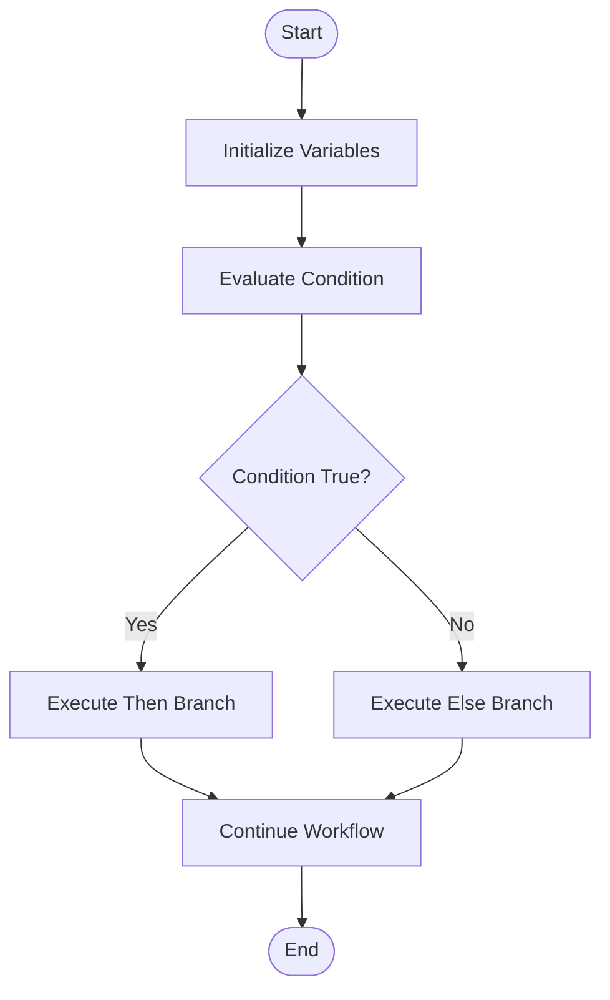

# UiPath If Condition

## Overview

This repository demonstrates the implementation of the **If activity** in UiPath Studio.

The If activity is used to evaluate a Boolean condition and execute different sequences of activities based on whether the condition evaluates to True or False.

It helps implement decision-making logic in RPA workflows and allows automation processes to handle different scenarios dynamically.

## Objectives

- Understand the If activity in UiPath.
- Implement conditional logic in automation workflows.
- Evaluate Boolean expressions.
- Execute activities based on True or False conditions.
- Handle different business scenarios.
- Improve workflow flexibility and control.

## Key Features

### 1. Condition

Defines the Boolean expression that needs to be evaluated.

Examples:

```vb
age >= 18
```

```vb
String.IsNullOrEmpty(name)
```

```vb
amount > 1000
```

### 2. Then Branch

Executes when the specified condition evaluates to **True**.

Example:
- Display a success message.
- Process valid records.
- Continue with the next automation step.

### 3. Else Branch

Executes when the specified condition evaluates to **False**.

Example:
- Display an error message.
- Handle invalid records.
- Execute an alternative workflow.

## Process Workflow

1. Initialize the required variables.
2. Define the condition to evaluate.
3. Add the If activity to the workflow.
4. Configure the Boolean expression.
5. Add required activities inside the Then branch.
6. Add alternative activities inside the Else branch.
7. Execute the workflow and validate the result.

## Process Flow Diagram



## Example Scenario

**Scenario:** Check whether an employee is eligible based on their age.

Condition:

```vb
employeeAge >= 18
```

- **True:** Display "Employee is eligible".
- **False:** Display "Employee is not eligible".

## Example Use Cases

- Validate mandatory input fields.
- Check whether an Excel file exists.
- Verify whether a value meets business criteria.
- Check whether a record is valid or invalid.
- Compare numerical or text values.
- Control workflow execution based on business rules.
- Execute different actions based on application conditions.

## Tools and Technologies

- **UiPath Studio** – Developing automation workflows.
- **If Activity** – Implementing conditional logic.
- **Variables** – Storing input and output values.
- **Boolean Expressions** – Evaluating conditions.
- **Message Box** – Displaying conditional results.

## Exception Handling

Consider handling the following scenarios:

- Null or empty variable values.
- Incorrect data types.
- Invalid input values.
- Unexpected runtime exceptions.
- Incorrect Boolean expressions.

Use appropriate validation and Try Catch activities wherever required.

## How to Run

1. Clone or download this repository.
2. Open the project in UiPath Studio.
3. Restore the required dependencies.
4. Open `Main.xaml`.
5. Initialize the required variables.
6. Configure the If condition.
7. Execute the workflow.
8. Verify the Then and Else branch outputs.

## Best Practices

- Use clear and meaningful Boolean expressions.
- Initialize variables before evaluating conditions.
- Avoid unnecessary nested If activities.
- Validate input data before applying conditions.
- Use Switch activities when multiple distinct values need to be evaluated.
- Keep Then and Else branches simple and readable.

## Expected Outcome

The automation evaluates the specified condition and executes the appropriate branch based on the result.

This demonstrates how conditional logic can be used to control workflow execution and implement business rules in UiPath.

## Purpose

This repository serves as a practical reference for understanding and implementing conditional logic using the If activity in UiPath Studio.

---

**Technology:** UiPath RPA  
**Activity:** If  
**Category:** Conditional Logic
